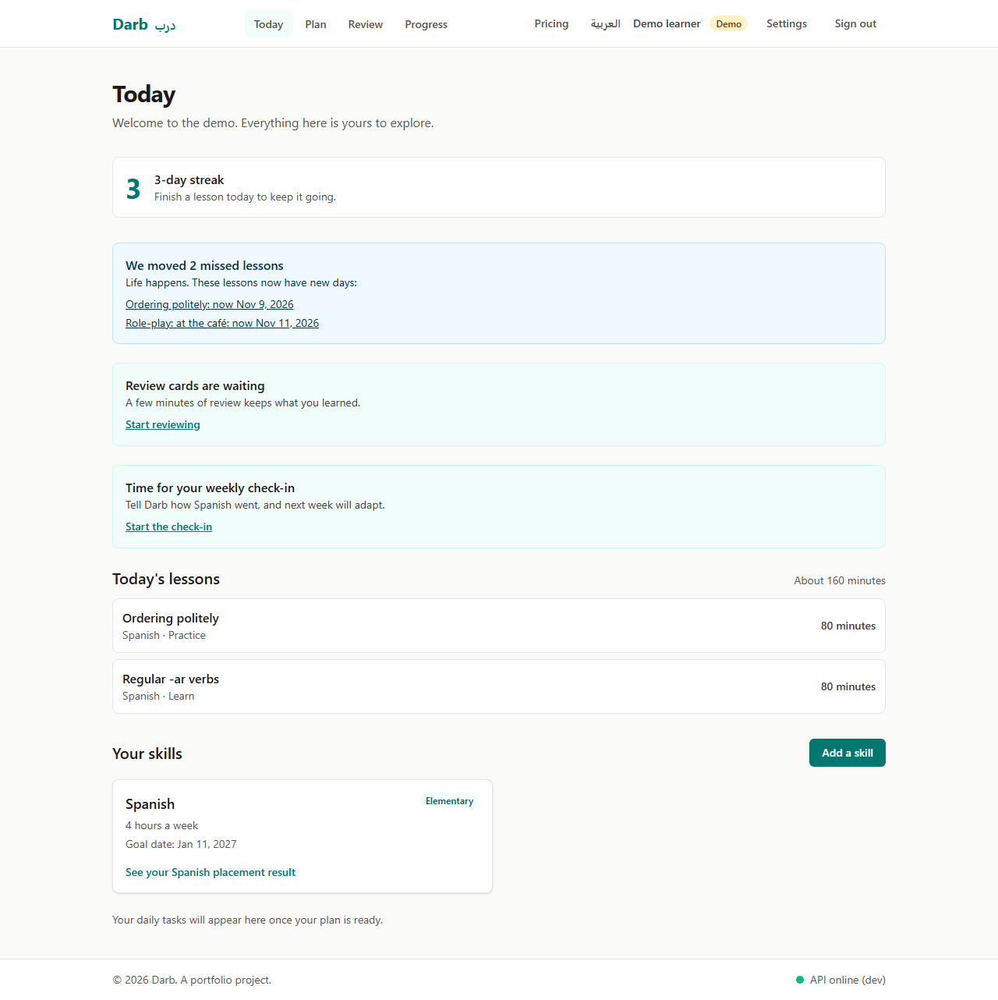
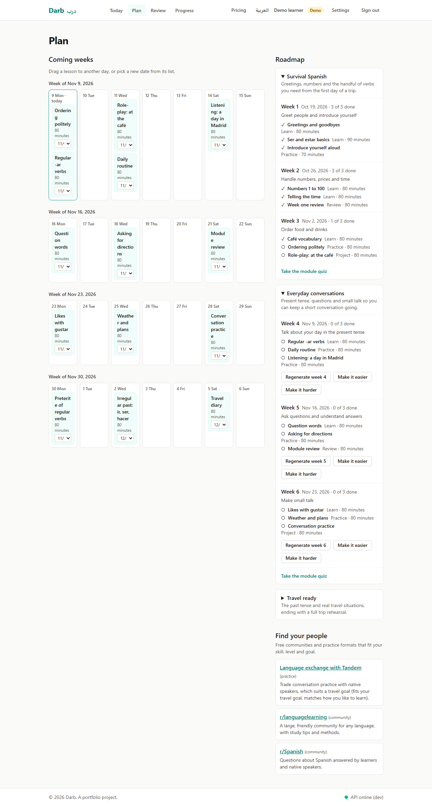
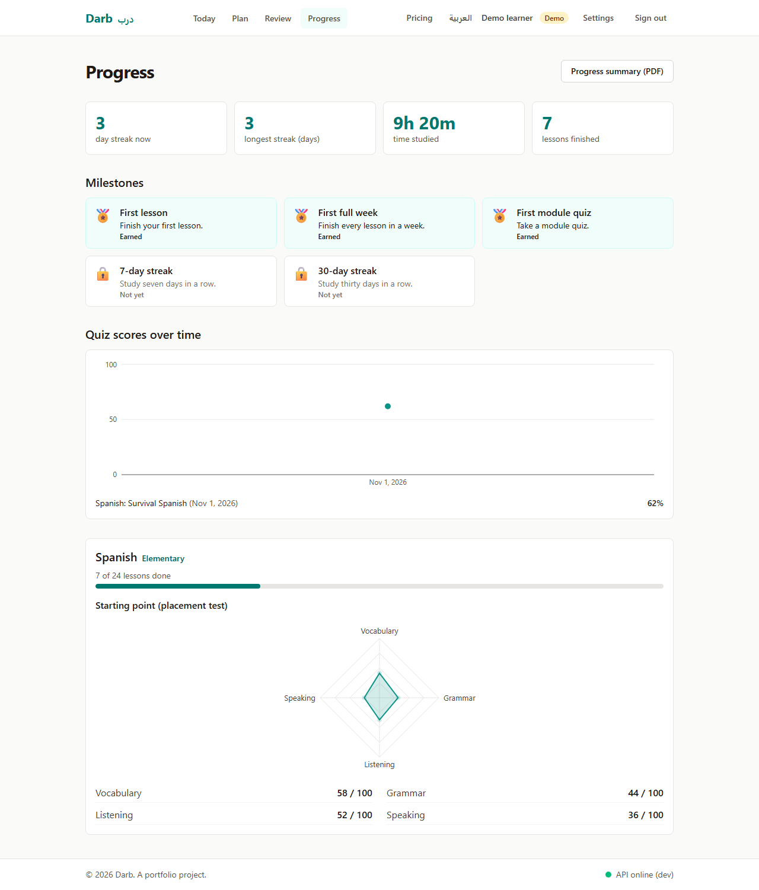
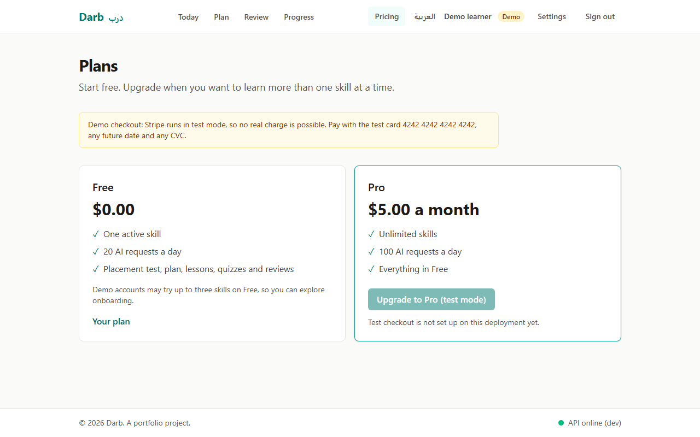
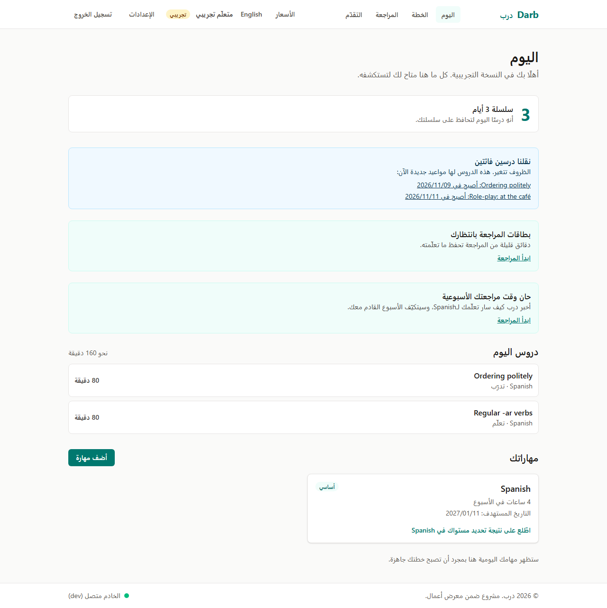
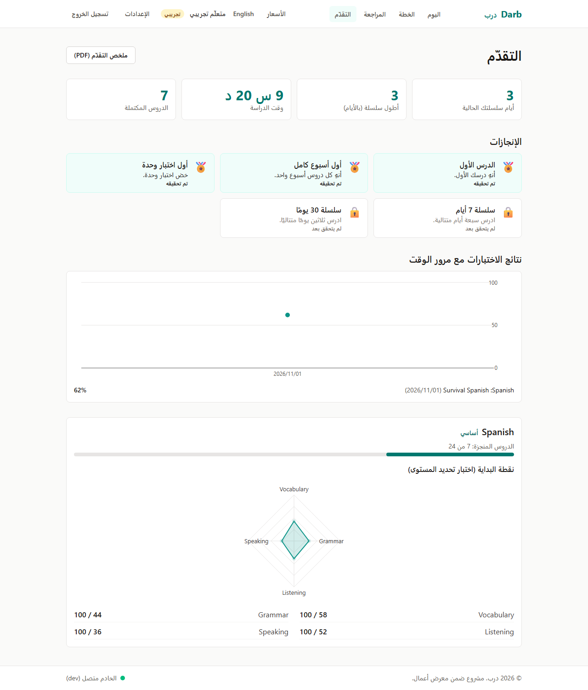
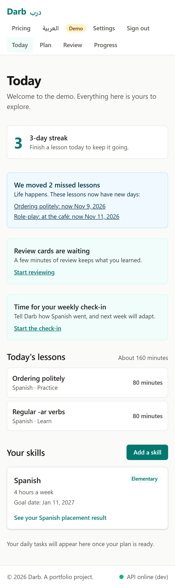
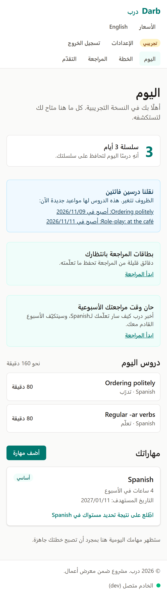
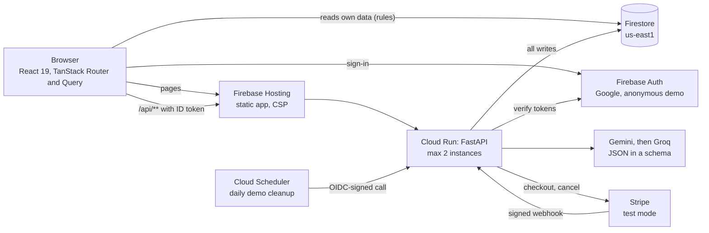

# Darb (درب)

**Learn any skill with a personal AI plan that adapts week by week.** Darb is Arabic for "path".

Pick a skill (a language, coding, guitar, cooking, public speaking...), take a short adaptive
placement test, and get a weekly plan scheduled on the days you said you are free. Darb then
tracks what you do, quizzes you, brings back what you got wrong, notices when you fall behind, and
rewrites next week from your check-in. It works fully for a single user, in English and Arabic.

**Live demo: https://darb-learn.web.app.** Press **Try the demo** to land in an account three weeks
into a Spanish plan, with a streak, quiz history, review cards and a check-in waiting.


> A portfolio project. Payments run in **Stripe test mode only**; no real charge is possible.

## Features

| Area              | What you can do                                                                                                                                                                                                                      |
| ----------------- | ------------------------------------------------------------------------------------------------------------------------------------------------------------------------------------------------------------------------------------ |
| Onboarding        | A 7-step wizard (one question per screen, back and next keep answers, inline validation, review step), saved across reloads                                                                                                          |
| Placement         | An adaptive AI quiz served one question at a time, easy to hard, stopping early; level and per-sub-skill radar. Answer keys never reach the browser                                                                                  |
| Plan              | Modules, weekly goals and short lessons sized to your hours, dated on your preferred days; drag lessons (or "Move to" on phones); regenerate a week easier or harder                                                                 |
| Today             | Phone-first daily screen: streak, today's lessons with a time estimate, catch-up list, notices for moved lessons, due reviews and check-ins                                                                                          |
| Lessons           | AI-written explanation, an exercise and vetted free resources; a tutor that answers in the lesson's context                                                                                                                          |
| Practice          | Module quizzes; every miss becomes a spaced-repetition card (Leitner boxes, 1 to 30 days)                                                                                                                                            |
| Adapting          | Missed lessons move to your lightest upcoming day automatically, and Today says what moved; the weekly check-in rewrites next week and explains why                                                                                  |
| Progress          | Hours, streaks, quiz scores over time, badges, starting radar, community suggestions, and a printable self-issued summary                                                                                                            |
| Plans and billing | Free (1 skill, 20 AI requests a day) and Pro (unlimited skills, 100 a day) with Stripe test-mode checkout, confirmation and cancellation                                                                                             |
| Settings          | Profile, AI usage meter, language (the AI writes in it too), in-app reminders, delete account and all data                                                                                                                           |
| Everywhere        | English and Arabic: tests come in both at once, plans and lessons are translated when you switch; full right-to-left layout; keyboard and screen reader friendly (axe checks in CI); reduced motion; loading, empty and error states |

|                                             |                                                   |
| ------------------------------------------- | ------------------------------------------------- |
|               |                       |
|         |                 |
|  |  |

<p>
  
  
</p>

## Architecture



- **The browser reads, the API writes** ([ADR 0002](docs/adr/0002-client-reads-api-writes.md)).
  Security rules let users read only their own tree and write nothing; every change goes through
  the API, which verifies the Firebase ID token on every request.
- **One schema source.** Pydantic models generate a JSON Schema, TypeScript types and Zod schemas
  in `shared/`, so the API, the forms and the AI output share one contract; CI fails on drift.
- **Pure domain logic.** Scheduling, rescheduling, spaced repetition, streaks, levels, badges and
  plan limits are framework-free functions with unit tests (`api/src/darb_api/domain`).
- **Cheap by design.** Cloud Run scales to zero; AI calls are metered per user and per day, and a
  failed call is refunded; prompts are versioned templates in `api/src/darb_api/prompts`.

## How AI output is validated

Every AI reply is parsed into a Pydantic model and checked against its rules (for example: every
quiz question uses a listed sub-skill, multiple choice answers point at a real option, a week's
lessons fit the learner's hours). An invalid reply gets one repair attempt that quotes the exact
validation errors; if that fails, the next provider is tried. Output that never validates is not
shown. Dates are never chosen by the AI, links are kept only for trusted learning sites, content is
shown as plain text (never HTML), and answer keys stay on the server until a quiz is submitted.

## Key decisions and trade-offs

- **Cloud Run behind Firebase Hosting** instead of Cloud Functions: one container, same-origin
  `/api`, no CORS, with hard spending caps ([ADR 0003](docs/adr/0003-cloud-run-behind-firebase-hosting.md)).
- **Gemini with a Groq fallback** keeps the free tiers usable when one provider is rate-limited
  ([ADR 0004](docs/adr/0004-gemini-with-groq-fallback.md)).
- **Soft daily limits** with atomic increments, not transactions: concurrent requests may overshoot
  by one or two, but nobody contends on the global counter.
- **Stripe without the SDK**, test keys only (a live key stops the API from starting); checkout is
  confirmed both by the returning browser (checked with Stripe) and by a signed webhook
  ([ADR 0007](docs/adr/0007-stripe-test-mode-billing.md)).
- **Computed, not stored:** badges and streaks are derived from activity, so they cannot drift.
- Every assumption made without the product owner is listed in
  [`docs/assumptions.md`](docs/assumptions.md); all decisions are in [`docs/adr/`](docs/adr/).

## Repository layout

| Path        | What it holds                                                                          |
| ----------- | -------------------------------------------------------------------------------------- |
| `web/`      | React 19 + TypeScript + Vite frontend                                                  |
| `api/`      | FastAPI backend (Python 3.12), deployed to Cloud Run                                   |
| `shared/`   | JSON Schema, TypeScript types and Zod schemas generated from the API's Pydantic models |
| `firebase/` | Firestore security rules, indexes and rules tests                                      |
| `e2e/`      | Playwright end-to-end and accessibility tests, and the README media capture            |
| `infra/`    | Google Cloud setup scripts                                                             |
| `docs/`     | Architecture decision records, assumptions, README media                               |

## Run it locally

Needs Node 22.12+, pnpm 10, [uv](https://docs.astral.sh/uv/) and Java 21+ (for the Firebase
emulators). Everything runs offline against the emulators (project `demo-darb`) with a
deterministic fake AI, so no cloud account or key is needed.

```sh
pnpm install
cp api/.env.example api/.env
pnpm emulators   # Auth on :9099, Firestore on :8180, emulator UI on :4000
pnpm dev:api     # http://127.0.0.1:8000/api/health
pnpm dev:web     # http://localhost:5173, proxies /api to the API
```

## Checks

```sh
pnpm format:check && pnpm lint && pnpm typecheck && pnpm test && pnpm build
pnpm test:emulator  # Firestore rules and the API's Firestore layer, against the emulator
pnpm test:e2e       # Playwright on desktop and phone, including axe accessibility scans
pnpm gen:schemas    # regenerate shared types and Zod schemas after changing an API model
pnpm screenshots    # re-capture docs/media (screenshots and the demo video)
cd api && uv run ruff check . && uv run mypy && uv run pytest
```

Before the first E2E run: `pnpm --filter @darb/e2e exec playwright install chromium`.

## Deploy

Pushes to `main` deploy after CI passes: the API image to Cloud Run, then the frontend, Firestore
rules and indexes to Firebase Hosting. Pull requests get a Hosting preview URL. Deploys are
keyless (Workload Identity Federation).

One-time setup, each script safe to re-run:

1. [`infra/gcp-setup.sh`](infra/gcp-setup.sh): APIs, service accounts, the deploy identity.
2. [`infra/set-secrets.sh`](infra/set-secrets.sh): stores the Gemini, Groq and Stripe test keys in
   Secret Manager and points the deploy at them. Without AI keys the app still runs and AI
   features say the AI is resting; without Stripe keys the pricing page says checkout is not set up.
3. [`infra/set-demo-cleanup.sh`](infra/set-demo-cleanup.sh): a daily job that erases demo
   accounts a week after they were started.
